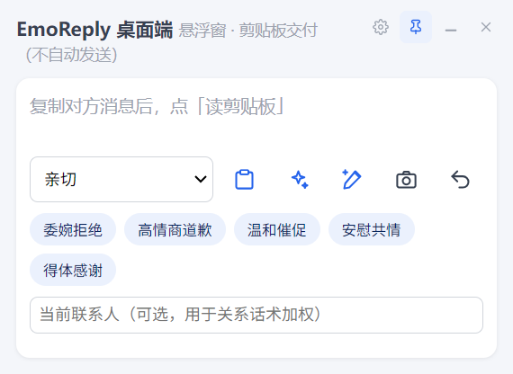
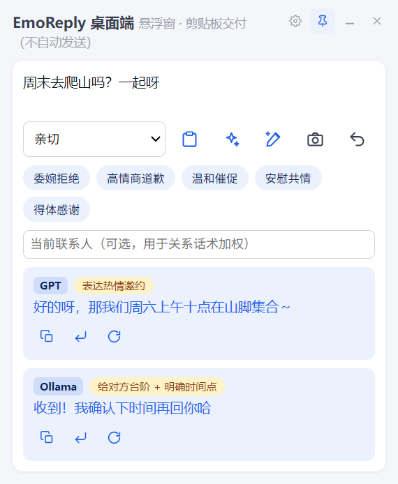
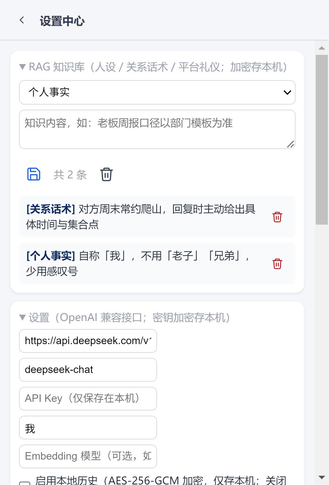
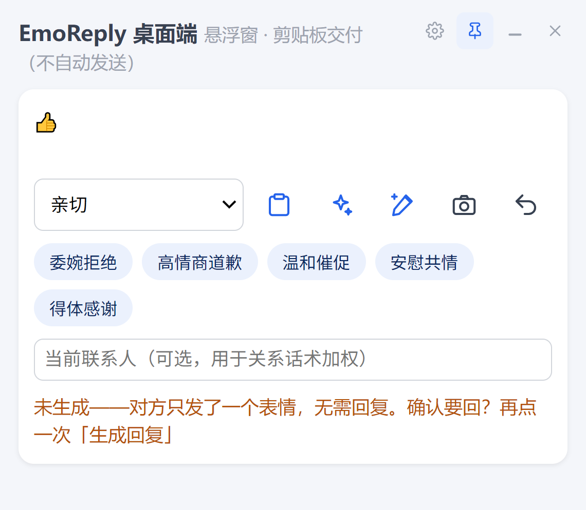
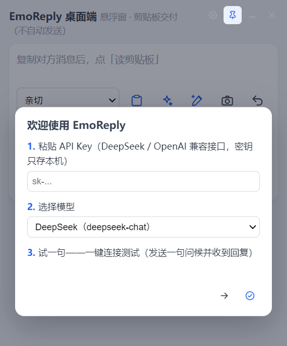
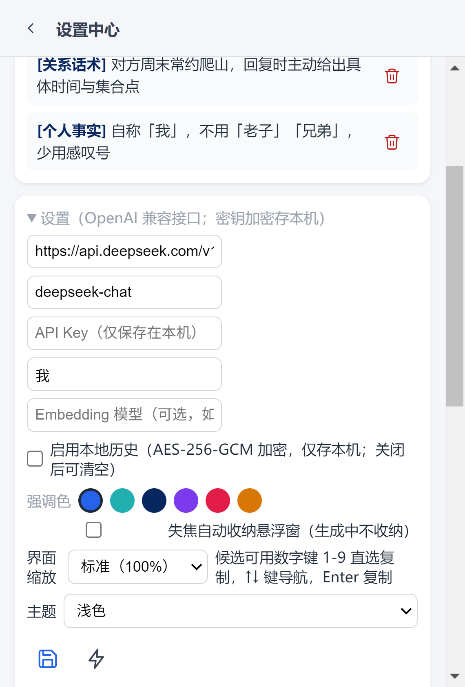
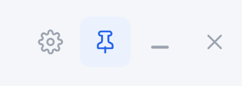

<div align="center">
  

# EmoReply · 高情商聊天回复助手

读屏/剪贴板拿到对方的话 → 本地预处理 → 云端 LLM 生成可直接发送的候选回复 → 一键注入聊天输入框。
**Android 输入法 + Electron 桌面端 + Python 核心链路（概念验证阶段）**

    


**把「这句话怎么回」，变成一次点击。**

</div>

## 简介

EmoReply（情商回复助手）是一款跨平台的高情商聊天回复助手。它只做一件事：把你正发愁的那句话，变成几条可以直接发送的得体回复。

聊天时最难的是「这句话怎么回才得体」。EmoReply 把这个动作压成一次点击：复制对方的消息，按一次按键——读取当前对话（剪贴板、手动粘贴或无障碍读屏），理解语境与情绪，结合你设定的人设、关系与常用话术，生成多条附有「为什么这样回」说明的候选。你在输入法候选条或桌面悬浮窗里点一下，回复就落进聊天输入框；是否发送，始终由你决定。

核心取舍：**宁可不生成，也不生成迎合风险内容**——接入人称/风险护栏；**密钥不出设备**——云端模型地址与 API Key 由用户运行时自填，本机加密存储，仓库内不硬编码任何凭据。

| 一键直达 | 每条都带理由 | 三重边界 |
| --- | --- | --- |
| 复制 → 按键 → 候选，结果落进你正在用的聊天框，不用切换应用。 | 候选附「为什么这样回」，让你判断而不是盲选，久用还能学到话术。 | 只读 + 复制、绝不自动发送、密钥不出设备，用起来没有账号风险。 |

<p align="center">
  <br>
  <sub>主界面：读剪贴板、生成回复、美化、截图取文四个入口</sub>
</p>

我们做了一个明确的取舍：宁可不生成，也不生成迎合风险的内容。当消息涉及施压、欺诈或明显不适配的请求时，EmoReply 给的是提醒，而不是一段「陪着说」的文本。这条边界，决定了它是一款敢长期用的工具，而不是一个会坑你的玩具。

## 我们解决什么问题

聊天真正的成本，从来不是打字，而是判断：这句话该不该回、用什么语气回、回完对方会怎么想。EmoReply 瞄准的就是这三件事。

- **漏回与拖延**：消息太多，重要那条沉底；等想起来，时机已经过了。
- **语气踩雷**：同一句话对领导、对客户、对朋友，需要三套完全不同的说法，临场很难切换。
- **社交成本**：一句话反复删改十分钟，发出去还在想「是不是太生硬」。

传统做法与 EmoReply 的差别，可以概括成一张表：

| 维度 | 手动回复 | 通用 AI 聊天工具 | EmoReply |
| --- | --- | --- | --- |
| **获取对话** | 自己复制粘贴 | 来回切换窗口粘贴 | 剪贴板一键 / 读屏自动 / 截图 OCR |
| **落到输入框** | 手动输入 | 复制回去，再粘贴 | 点选即注入，可一键撤回 |
| **人设与关系** | 全靠自己记 | 每次口头交代背景 | 知识库按联系人加权检索 |
| **为什么这样回** | 无 | 要追问才解释 | 每条候选自带一句理由 |
| **隐私** | — | 对话留在平台会话里 | 密钥本机加密，候选仅内存存续 |

## 核心功能

EmoReply 的能力围绕一条链路组织：拿到对话 → 判断要不要回 → 理解语境 → 生成候选 → 交付到输入框。每一环都可以单独使用，也可以串成一次按键。

### 1. 三种取对话方式，总有一种适配你的场景

取不到对话内容，一切智能都无从谈起。EmoReply 提供了三条互补的入口，按可用性自动选择：

- **剪贴板一键**：复制对方消息，按一次读取键即可，适配任何能复制的聊天界面。
- **手动粘贴与输入**：需要补充上下文或多条拼接时，直接编辑消息区。
- **无障碍读屏**：直接读取聊天界面的节点树，无需复制；遇到主动保护节点树的应用（如微信），自动回落到**端侧 OCR**（ML Kit 中文，不依赖 Google 服务），离线可用。

桌面端另有独立的截图取文能力：调用系统截屏后本地 OCR 识别（tesseract.js，模型随安装包分发），全程不出本机。对于「对方发来的是一张图」这类场景，一样能接住。

读屏路径还包含一个容易被忽略的细节——**方向判侧**。EmoReply 依据气泡颜色判断哪条是「我方」、哪条是「对方」（浅色 #95EC69 一类绿、深色按相对亮度），页面基线兼容聊天背景图渐变；颜色证据不足时回退到位置判据，并在状态行明确提示「方向可能有误」，内嵌截图的图内文字按像素几何剔簇排除。宁可提示不确定，也不假装自己读对了（判侧口径与阈值表见 `docs/设计决策记录.md` §5）。

### 2. 不只给答案，还给理由

一次生成返回多条候选，每条都附一句「为什么这样回」——是共情、是澄清事实，还是直接给行动建议。你可以根据对方的性格与关系亲疏挑选，而不是把判断权交给一个黑盒。

- **语气强度可调**：从「理性克制」到「活泼外放」一条滑杆，同一段内容可以拿到不同浓度的表达；语气风格另可选侧重（情感共鸣 / 事实澄清 / 行动建议）。
- **换一批**：不满意就重生成，候选之间做去重，避免反复看到同一个句子。
- **多模型并行对比**：桌面端可同时挂多套模型，一次提问并行出结果，每条候选标注来源模型，方便对比择优。
- **流式输出**：文字边生成边呈现，等待感被压缩到最低。
- **一键交付与撤回**：点选候选即复制或注入输入框；注入错了，一键撤回上一次操作。输入法侧另有清空会话、切换到系统输入法、模板另存与快速点选，候选表情可整体开关。

<p align="center">
  <br>
  <sub>候选卡：来源模型、语气标签、正文与复制 / 回填 / 换一条三个动作（演示文案）</sub>
</p>

### 3. 懂你的人设，也懂你和他的关系

通用的「高情商话术」往往让人一眼看出是模板。EmoReply 的做法是把你的个人设定喂进生成链路：怎么自称、哪些词绝对不说、对这个人该用什么分寸。

- **人设与禁语**：自称、口头禅、禁用词写进提示词，输出侧再做一道禁语拦截，双保险。
- **RAG 知识库**：人设、关系话术、平台礼仪分门别类入库，生成时按联系人加权检索，命中才注入——不命中的内容不会污染提示词。
- **个人语气学习**：导入自己的聊天记录，自动抽取高频句式沉淀为语料，让生成的回复更像「你会说的话」。
- **本机加密**：知识库整体加密落盘，密钥由设备本地派生，不上传。

<p align="center">
  <br>
  <sub>设置中心的知识库：按个人事实 / 关系话术 / 平台礼仪分类，可绑定联系人与逐条删除（演示词条）</sub>
</p>

### 4. 有边界的智能：不迎合、不打扰

愿意长期留在你电脑和手机里的助手，首先得让人放心。EmoReply 在三个位置做了硬约束：

- **生成前先判断要不要回**：纯表情、通知类、寒暄收尾这类消息默认不生成，把打扰成本压到最低；真正需要回的消息照常处理。判定拿不准时一律放行，需要时点第二次即可强制生成。
- **输入侧风险筛查**：消息本身涉及施压、可疑请求时，给的是风险提示，而不是一段配合的话术。
- **输出侧过滤**：格式符、元话语拒答、越界内容统一清洗，交付给你的是干净正文。

<p align="center">
  <br>
  <sub>对方只发一个表情时，先拦下不生成，并说明原因与强制生成的入口</sub>
</p>

### 5. 桌面效率套件：把重复动作做成一键

桌面端不只是移动端的放大版，它承担了高频、多任务的重活：

- **快捷指令栏**：内置委婉拒绝、高情商道歉、温和催促、安慰共情、得体感谢等场景包，也支持自定义指令，可为每条指令单独绑定模型。
- **全局热键**：在任何应用里复制消息，按一次快捷键呼出悬浮窗，剪贴板新内容会被自动读入并触发生成。
- **本地 HTTP 接口**：在 `127.0.0.1:17777` 暴露 `/health` 与 `/generate`，方便接入脚本、批量测试或你自己的小工具；只监听本机，不对外网开放。
- **首次运行向导**：三步走完：填 Key → 选模型 → 试一句。连不上会明确告诉你卡在哪一步，而不是沉默失败。

<p align="center">
  <br>
  <sub>首次运行向导：填 Key、选模型、试一句，三步完成配置</sub>
</p>

### 6. 隐私不是选项，是默认值

- **密钥不出设备**：API Key 由你自填，走操作系统密钥保护能力加密存储（Windows 下即 DPAPI），仓库与安装包里没有任何硬编码凭据。
- **历史默认不存**：不开启就一条不留；显式开启后以 AES-256-GCM 在端侧加密落盘，最多保留 50 条，随时可一键清空。
- **候选仅内存存续**：生成结果不落聊天记录（ReplyStore），通知链路的内容不入库、不外传。
- **读屏显式触发**：只在你点击时读一次，没有后台自动抓取。
- **异常可解释**：设置文件采用原子写入，损坏时自动备份并重建；配置有问题会明确提示，不静默降级。

### 7. 看得舒服，用得顺手

- **三档主题**：浅色、深色、跟随系统，深色模式下支持 AMOLED 纯黑（输入法面板与 App 同步），省电也更沉静。
- **强调色与缩放**：六档强调色可换；界面缩放适配高分屏与视力需求。
- **图标化操作**：桌面端全部动作以图标呈现，悬停给出「名称｜功能说明」，新手也不必猜。
- **键盘友好**：方向键在候选间移动，数字键直接选中第 N 条，回完一句不用碰鼠标。
- **常驻低开销**：窗口隐藏时自动暂停动画与高频刷新，挂着不心疼电。

<p align="center">
  <br>
  <sub>设置中心：主题、强调色、界面缩放与各类偏好集中在一处</sub>
</p>

### 8. 桌面窗口：置顶、最小化、关闭到托盘

悬浮窗的窗口行为按「随手可用、不添麻烦」设计，所有窗口动作收在右上角一组图标里：

<p align="center">
  <br>
  <sub>右上角窗口控制：设置中心、置顶（图中为已置顶态）、最小化、关闭到托盘</sub>
</p>

- **一键置顶 / 取消置顶**：按钮状态即时反馈（图标与文字提示同步切换），选择会持久化，下次启动保持不变；置顶与其他应用抢焦点无关，始终按你的设定。
- **最小化到任务栏**：需要腾出桌面时收进任务栏，任务栏可随时唤回。
- **关闭到系统托盘**：点关闭只是把窗口收起，程序继续在托盘运行，单击托盘图标即可复原——避免「关一下就得重新配置」的糟糕体验。
- **托盘不可用时降级**：若系统托盘初始化失败，关闭动作自动降级为最小化，并在界面明确提示「程序未退出」，绝不静默退出。
- **位置记忆与吸附**：窗口靠近屏幕边缘自动吸附贴边，位置记住，重启后回到原处。

> 以上配图均取自桌面端当前构建的真实界面（隔离测试档案拍摄，2026 年 10 月按 3 倍像素密度重拍），未做内容合成；标注「演示」的词条与文案为演示数据。移动端（输入法）界面截图需真机拍摄，暂未纳入本文件。

## 典型使用场景

**职场沟通：把「得体」变成标配。** 领导临时抛来一段需求、同事跨部门来催进度、客户在群里表达不满——这些消息的共同点是：不能敷衍，又不能太生硬。EmoReply 会先判断这条是否真的需要回复，再给出「先接住情绪、再给明确答复」的候选，并附上这样组织的理由，让你在几秒内完成一次高质量回复。

**亲密关系：接住那些没说出口的话。** 一句「随便」背后可能是疲惫，也可能是失望。EmoReply 结合关系知识库与语气强度调节，给出从「安抚」到「直接给方案」的不同版本，你可以选一个最像自己的说法，再改两个字发出去。

**客服与销售：多会话并发也不掉链子。** 同时开十几个对话窗口，回复速度和口径一致性同样重要。桌面端的多模型并行与快捷指令栏，可以把「道歉 + 补偿方案 + 下一步」这类固定结构固化成一键指令，把注意力留给真正需要判断的客户。

**社交焦虑：先拿到几个不尴尬的版本。** 不想回、又不得不回的消息，最耗心力。EmoReply 的价值不是替你社交，而是把「从零开始组织语言」变成「从三个还不错里挑一个」——门槛降下来，回复才发得出去。

## 适用人群

- **职场人**：跨部门协作、向上汇报、对客沟通频繁，需要稳定的语气分寸。
- **销售、运营与客服**：会话量大、回复时效要求高，需要统一口径与快速生成。
- **社交焦虑人群**：面对消息容易过度斟酌，需要低门槛的起步版本。
- **多应用重度用户**：微信、钉钉、邮件来回切换，希望用一个入口统一处理。
- **小团队**：希望把话术标准沉淀下来，新人也能快速对齐表达风格。

## 为什么选择 EmoReply

- **交付位置对了**：回复最终落在你正在使用的输入框里，而不是又一个需要切换的网页或 App。工具应该消失在工作流里。
- **判断权还给你**：每条候选都解释理由，长期使用是学习，不是依赖。
- **边界清晰**：只读 + 复制、不自动发送、不读取聊天数据库、不模拟点击——把合规风险留在门外。
- **可以私有**：密钥本机加密、历史默认不存、知识库加密落盘，敏感数据不出设备。
- **不被单一模型绑定**：任何 OpenAI 兼容接口都能接入，也可以接本机 Ollama 跑端侧模型；桌面端还提供本地 HTTP 接口，便于与自有工具串联。

## 技术规格与平台支持

| 项目 | 说明 |
| --- | --- |
| **移动端** | Android 输入法（IME）+ 通知捕获 + 无障碍读屏 + 端侧 OCR，Kotlin 实现 |
| **桌面端** | Electron 悬浮窗（Windows / macOS）：多模型并行、流式输出、快捷指令、离线 OCR、本地 HTTP API |
| **生成引擎** | 任意 OpenAI 兼容接口（DeepSeek / OpenAI / 通义等），亦可接入本机 Ollama 端侧模型 |
| **核心链路** | Python 参考实现作为事实源，移动端与桌面端保持同构演进 |
| **密钥存储** | 操作系统密钥保护能力加密（如 Windows DPAPI），不出设备 |
| **历史存储** | 默认不存；开启后 AES-256-GCM 端侧加密，最多 50 条，可一键清空 |
| **网络出站** | 仅你自填的 LLM 接口；本地 HTTP API 只监听 `127.0.0.1` |
| **首次配置** | 三步向导：填写 API Key → 选择模型 → 试一句；失败有明确提示与降级路径 |

> 当前处于概念验证阶段，不提供服务端。除你配置的云端模型接口外，产品不做其他联网行为。

## 立即体验

EmoReply 目前以概念验证版本开放体验，桌面端可自行构建运行，移动端支持真机安装——具体命令见下方[快速开始](#快速开始)。

- **桌面端**：`cd desktop-app && npm install && npm start` 即可启动悬浮窗，配置 API Key 后即可生成。
- **移动端**：构建调试安装包后安装，并在系统设置中完成三步授权：**通知使用权** → **启用输入法** → **设为默认输入法**。
- **反馈**：使用中的问题与场景需求，欢迎通过 [Issue](https://github.com/wangnan05563/EmoReply/issues) 反馈，我们会优先处理影响「回得出去」的问题。

让你的下一句回复，既得体，也像你自己。

---

## 目录结构

```
android-app/    Android 端（输入法 IME、通知捕获、无障碍读屏 + OCR；Kotlin）
desktop-app/    Electron 桌面端（悬浮窗 + 剪贴板交付；含本地 HTTP API 与离线 OCR）
ios-app/        iOS 侧实现（需 macOS / Xcode 环境构建，本机无构建链路）
m1-poc/         平台无关核心链路的 Python 参考实现 + pytest 验收（事实源）
app-chat-reply-tool/  最早的可行性原型（两个 HTML demo + 设计说明，仅存档不维护）
assets/         README 产品配图（桌面端 UI 截图，隔离档案演示数据）
docs/           需求/设计/计划/报告与迭代 PRD（导航见 docs/README.md）
scripts/        Windows 一键脚本（构建打包、推送测试、环境搭建）
tools/          辅助脚本（品牌图/社交预览图生成、SVG→VectorDrawable 转换）
brand/          品牌资源（App 图标、GitHub 社交预览图，说明见 brand/README.md）
release/        Android 构建产物外置目录（gradle buildDirectory 指到这里；不入库）
desktop-app/perf/    桌面端性能压测脚手架（配置驱动）
cleanup-logs/   工作空间清理的审计与报告
```

> **双向演进约定**：新能力先在 `m1-poc` 落 Python 参考实现与测试，通过后再镜像到端侧 Kotlin/Swift 实现，保持两侧同构。

## 快速开始

### 桌面端（Electron）

```bash
cd desktop-app
npm install
npm start          # 启动悬浮窗
npm test           # 7 套冒烟（generate/sanitize/llm/tone/kb/ocr/settings，99 项断言）
npm run dist       # 生产构建（NSIS 安装包 + portable，各约 104MB，产物在 dist/）
npm run test:asar  # 打包态 OCR 回归（需先 npm run dist，验 asar 内 OCR 可用）
```

桌面端还提供本地 HTTP 接口（默认 `127.0.0.1:17777`）：`GET /health`、`POST /generate`（body `{text, style}`），便于脚本化与性能压测。

### 端到端 UI 测试（CDP 驱动，51 项断言）

```bash
cd desktop-app
rm -rf tmp/e2e-profile      # 首次准备；日常复跑不必清，脚本自己复位状态
env -u ELECTRON_RUN_AS_NODE ./node_modules/electron/dist/electron.exe . \
  --remote-debugging-port=9222 --user-data-dir=tmp/e2e-profile
# 另开终端
npm run test:e2e   # 51 项断言 + 截图（产物在 desktop-app/docs/screenshots/e2e-*.png）
```

> **profile 要求**：必须是独立 `--user-data-dir`。偏好（`emoreply_wizard_done`、云端配置等）
> 写穿到主进程 `settings.json`，用例开头会成套清掉这些键（删除同样写穿，见 `scripts/profile-guard.js`），
> 所以同一目录可以反复跑、配过 Key 也不影响「首次运行向导」两条断言；
> 事实源若落在系统默认配置目录（真实用户档案），脚本直接拒跑（exit 3）以免清掉用户配置。
> 窗口若被系统隐藏（`document.hidden=true`），脚本会跳过截图并提示重启实例。

### Android 端

环境：Windows + JDK 17 + Gradle 8.9（离线可用）。两种入口等价：

```bat
REM 一键：环境准备 + 构建打包（APK 落在 release\build\app\outputs\apk\debug\app-debug.apk）
scripts\安卓构建打包.cmd

REM 已装好环境、只想重装 APK 并跑一轮真机验证
scripts\安卓推送测试.cmd
```

> 构建产物统一外置到 `release/`（`android-app/app/build.gradle.kts:56` 把 `layout.buildDirectory` 指到这里），
> 该目录不入库；被清理后重跑上面的脚本即可再生成。

首次使用还需在系统设置里完成三步授权：**通知使用权** → **启用输入法** → **设为默认输入法**（应用首页可一键跳转对应设置页）。

### Python 核心链路（无真机也能验）

```bash
cd m1-poc
python -m pytest -q
```

## 配置

云端生成能力需要用户自填（应用内「设置」页填写，支持任意 OpenAI 兼容接口，如 DeepSeek / 通义 / OpenAI）：

| 配置项 | 说明 |
| --- | --- |
| 云端生成开关 | 关闭则全程走本地模板桩链路 |
| Base URL | OpenAI 兼容根地址（如 `https://api.deepseek.com/v1`），自动拼 `/chat/completions` |
| API Key | 仅存本机私有目录并加密，**不硬编码、不出设备** |
| 模型名 | 由所用服务提供 |

其余偏好（语气风格、语气强度、候代表情、暗色模式、AMOLED、精简键盘）同样保存在本机，可在设置页调整；配额/鉴权失败会明确提示并降级为本地模板，不静默失败。

## 核心链路

```
对话内容 → 预处理/去重 → 意图·情绪分类 → 上下文与提示词组装（人设+RAG）
        → 云端 LLM 生成 → 候选清洗（格式符/元话语/去重/表情收敛）→ 输出护栏
        → 输入法候选区展示（含理由）→ 点选注入聊天框 / 一键复制
```

- 意图与「是否真的需要回复」分开判定：**通知类消息默认不生成**（压打扰成本高于漏判成本）
- 伪历史按 token 预算从最旧开始截断，`system` 与当前消息永不丢弃
- 候选拆分与清洗有多层兜底（多候选挤在一段、忘带分隔符、标题标签混入、元话语拒答等）

## 文档

| 文档 | 内容 |
| --- | --- |
| [docs/README.md](docs/README.md) | **全部文档导航**（规格/设计/计划/调研/任务记录/质量报告） |
| `docs/EmoReply-产品介绍.docx` | **产品介绍（Word，含实机截图）**，本文件产品部分的来源 |
| `docs/需求规格说明书_高情商聊天回复助手.md` | SRS：范围、功能与非功能需求、验收口径 |
| `docs/概要设计说明书_高情商聊天回复助手.md` | 架构、模块划分、关键决策 |
| `docs/设计决策记录.md` | 设置页改版 / 多平台消息接入 / 读屏与候选优化 / 钉钉借鉴 / **气泡颜色方向判定（§5）** |
| `docs/品牌图标与接入.md` | 品牌资产清单 + Android/iOS/桌面三端图标接入与打包验证 |
| `docs/端侧模型下载指南.md` | 端侧模型预设、下载与校验 |
| 计划与里程碑 | 见 MTask「aimsg三期」项目（2026-10-30 文档精简后，本仓不再存放计划文档与任务卡） |
| 优化迭代 PRD / 设计 / 计划 / 跟踪矩阵 | 随文档精简归档，按任务号（T01160 / T01360 等）在 MTask 检索 |
| 桌面端 UI 全面测试 | 结论并入 `docs/CHANGELOG.md`；51 项断言截图见 `desktop-app/docs/screenshots/` |
| 代码质量治理记录 | 并入 `docs/CHANGELOG.md`（Sonar 增量报告与修复记录随 2026-10-30 精简归档） |
| `docs/Android测试环境搭建指引.md` | 真机环境、ADB 与常见问题 |
| `docs/CHANGELOG.md` | 清理、构建与修复的时序记录 |
| `desktop-app/docs/screenshots/` | UI 自动化截图（e2e 51 项断言产物 + CDP 视觉佐证） |
| `assets/screenshots/` | 本文件顶部至「核心功能」的产品配图 |
| `brand/README.md` | 品牌资源清单：图标尺寸矩阵、配色来源、**GitHub 社交预览图**再生成方式 |

## 品牌与社交预览图

| 资源 | 位置 | 说明 |
| --- | --- | --- |
| GitHub 社交预览图（OG） | `brand/social-preview.png` | 1280×640，README 顶部已内嵌；同一份文件建议上传到仓库 **Settings → Social preview**，这样分享链接时的卡片图与仓库内一致 |
| 三稿对应预览 | `brand/social-preview-cand-{a,b,c}.png` | 定稿为 cand-c（深蓝/青，与主标同源）；旧紫系版本备份在 `brand/_source/backup/` |
| App 图标 | `brand/png/`、`ico/`、`icns/`、`android/`、`ios/`、`favicon/` | 尺寸矩阵与自适应前景见 `brand/README.md` |

换稿或改色后重跑生成脚本即可复现（脚本即设计源文件，改顶部 `TITLE`/`SUBTITLE` 或 `_source` 母图）：

```bash
python tools/gen_social_preview.py
```

## 隐私与安全

- 只读取为生成回复所必需的内容；通知链路内容不入库、不外传，候选仅内存存续
- API Key 等敏感配置由用户自填并本机加密保存；**仓库内禁止提交任何密钥或含密钥的配置文件**
- 无障碍读屏为显式触发（点击读屏按钮读一次），无后台自动抓取

## 已知限制

- 概念验证阶段，未做服务端；联网能力仅限用户自填的云端 LLM 接口
- iOS 侧仅有工程代码，需 macOS 环境才能构建验证
- 部分 IM（如微信）主动保护无障碍节点树，故提供截图 + 端侧 OCR 回落路径；OCR 存在轻微识别波动
- 读屏判侧在**内嵌截图的消息**上，现有证据是离线回归 + 真机历史截图回放（图内文字簇过滤、「零证据不落我方」两条判据）；换新包后的现场复测仍建议补跑一轮，判据细节与残留边界见 `docs/设计决策记录.md` §5
- 桌面端安装包**不入库**（产物可再生），需要时 `npm run dist` 约 2 分钟重建；Android 产物同理落在被 gitignore 的 `release/`
- `npm run test:e2e` 需独立 `--user-data-dir`（脚本会复位其中偏好；落在系统默认配置目录时拒跑 exit 3），且窗口被隐藏时自动跳过截图
- 云端生成质量、粘贴回宿主窗口兼容性仍需真机 + 真实 Key 复核（见 MTask 待办 T01500/T01502）
- 本文件的产品配图只覆盖桌面端；输入法（Android）界面与真实聊天场景未纳入，需真机拍摄后按同一图序补充

## 贡献

个人概念验证项目，暂不接受外部 PR；问题与使用反馈欢迎提 [Issue](https://github.com/wangnan05563/EmoReply/issues)。

开发约定（提交前请过一遍）：

- 新能力先落 `m1-poc`（Python 参考实现 + pytest 验收），通过后再镜像到 Kotlin / Electron 端，保持三端同构
- 提交前跑通 `m1-poc` 的 `python -m pytest -q` 与桌面端 `npm test`；渲染层改动需再过 `npm run test:e2e`（独立 `--user-data-dir`）
- 不提交任何密钥、安装包产物，以及含真实聊天内容的真机截图等敏感内容；仓库内的产品配图（`assets/screenshots/`）与 UI 自动化截图一律来自**独立测试档案 + 演示数据**，重拍时须确认 Key 输入框为空、知识库/候选为演示内容
- 改 README 顶部图/换品牌色后重跑 `tools/gen_social_preview.py` 并同步 `brand/README.md`；换产品配图时替换 `assets/screenshots/` 同名文件并保持图序与题注一致

## 许可证

本仓库尚未包含 `LICENSE` 文件，版权归属以仓库所有者为准；在明确许可证前请视同「保留所有权利」。

## 致谢

- [Remix Icon](https://remixicon.com/)（MIT）：输入法图标行图标
- [Google ML Kit Text Recognition（Chinese）](https://developers.google.com/ml-kit/vision/text-recognition)：端侧 OCR
- 图标候选：[Agnes](https://www.agnes-ai.com/) 生成
