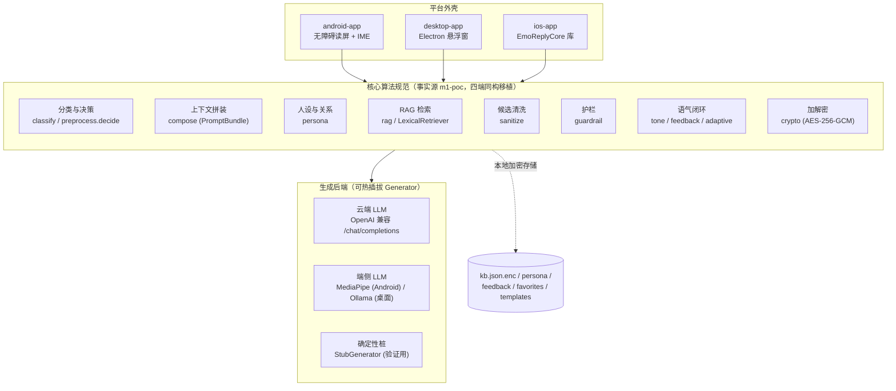
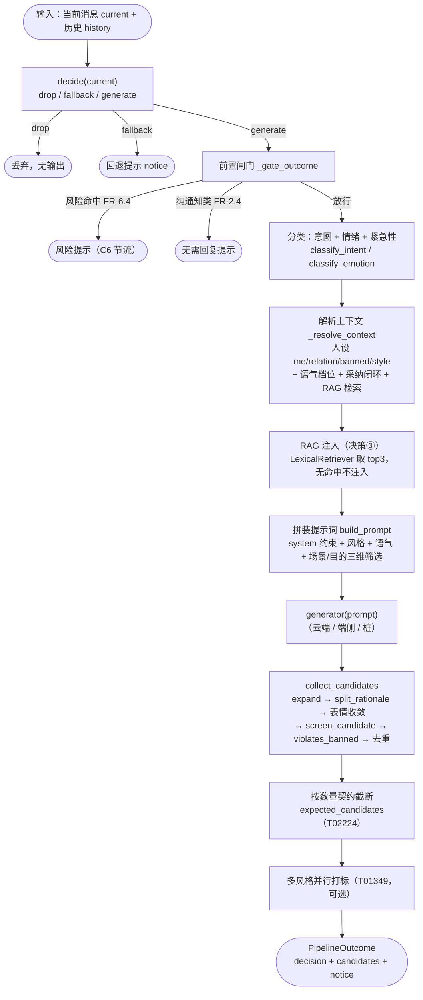
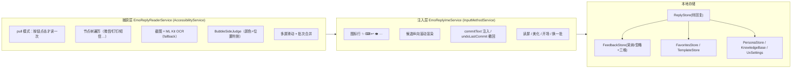
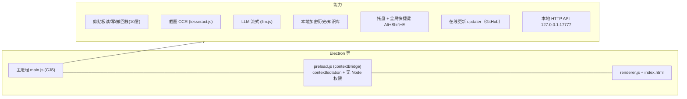
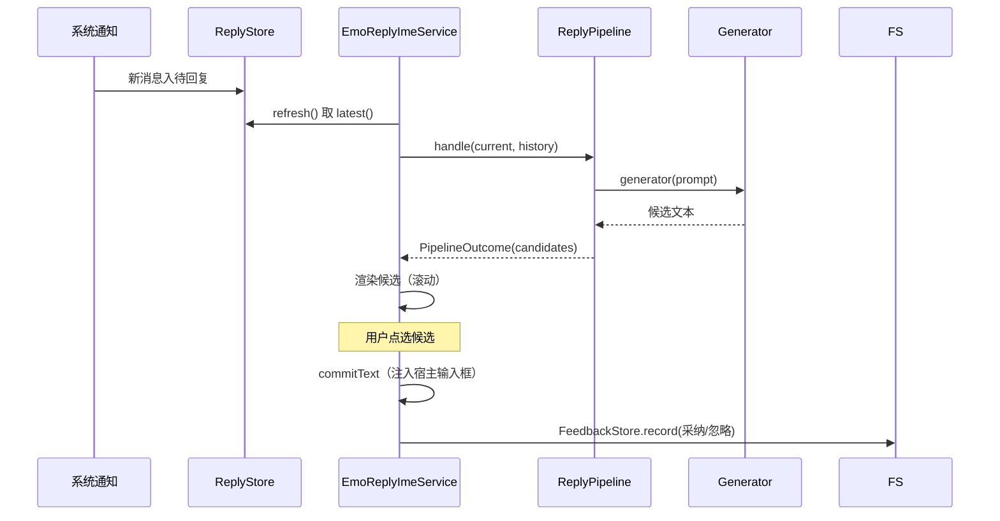
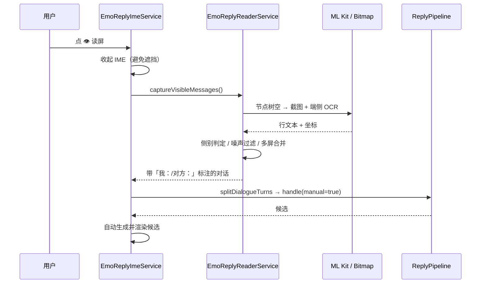
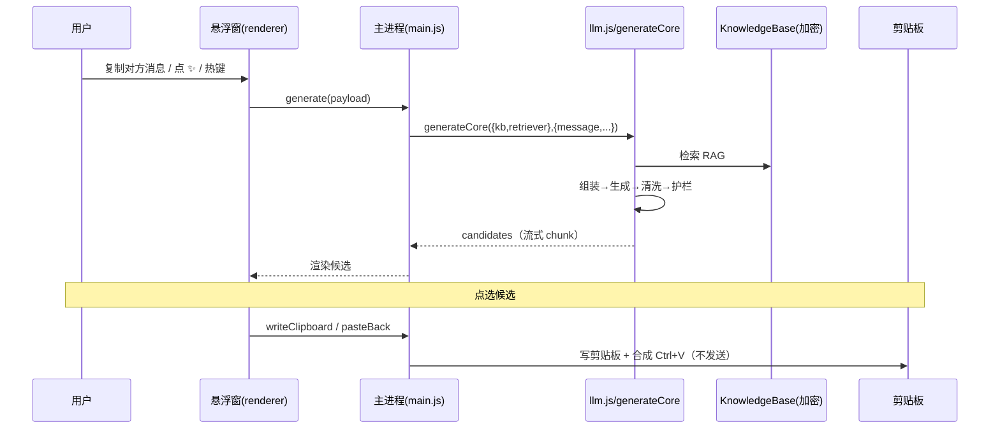
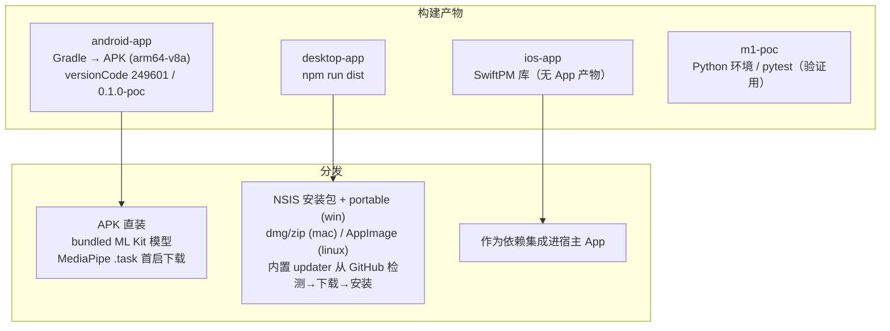

# EmoReply 系统架构设计文档

> 本文档基于当前工作空间内四套源代码（`m1-poc` / `android-app` / `desktop-app` / `ios-app`）整理，所有架构描述严格对应**现有实现**，未假设任何不存在的组件或功能。
> 文中 `FR-x.x`、`Cx`、`T0xxxx` 等编号均直接来自代码注释与提交中的可追溯标记，用于需求—实现双向追溯。

---

## 0. 文档说明与范围

| 项 | 说明 |
| --- | --- |
| 事实源 | `m1-poc`（Python）是核心算法的**事实源**，Android（Kotlin）、桌面（JS）、iOS（Swift）均为其同构移植 |
| 同构口径 | 四类模块（组装 / 清洗 / 护栏 / 检索）在四端保持函数级一一对应，注释中明确标注「与 m1-poc … 同构」 |
| 形态边界 | 桌面端仅实现管线「生成尾部」，捕获头部（通知判定）由手动/剪贴板入口替代；iOS 仅含核心库，无捕获层与 IME |
| 范围外 | 需求文档、PRD、测试矩阵、品牌资源等另见 `docs/` 下对应文档，本文不重复 |

---

## 1. 系统概述

### 1.1 产品定位

EmoReply 是一款**跨平台「高情商聊天回复助手」**。其本质是：读取对方消息 → 经 LLM 生成多条候选回复 → 注入宿主输入框 → 由用户选择并发送。

### 1.2 三条贯穿性约束

无论平台形态如何差异，以下约束在代码中贯穿始终：

1. **零留存（FR-6.1 / FR-6.2）**：聊天内容不落盘、不外传、处理完即弃；读屏与 OCR 仅在内存中处理（`Bitmap` 识别后立即 `recycle`，不写入文件）。
2. **本地加密（FR 隐私口径）**：人设库、RAG 知识库、本地历史均采用 **AES-256-GCM**，密钥不出设备。
3. **绝不自动发送（FR-4.2）**：任何端只把候选「注入输入框」或「写入剪贴板」，真正的发送永远由用户完成（桌面端连「一键回填」也只合成 `Ctrl+V`，不替用户点发送）。

### 1.3 四种工程形态

| 工程 | 语言 | 形态 | 捕获方式 | 注入方式 | 端侧能力 |
| --- | --- | --- | --- | --- | --- |
| `m1-poc` | Python 3 | 参考实现 / 事实源 | 无（直接喂 `Notification`） | 无（返回候选对象） | 生成用确定性桩跑通链路 |
| `android-app` | Kotlin (JVM 17) | Android App | 通知监听 + 无障碍读屏 | 输入法 `commitText` | ML Kit OCR、MediaPipe 端侧 LLM |
| `desktop-app` | JavaScript (Electron) | 桌面悬浮窗 | 剪贴板 / 截图 OCR | 写剪贴板 + `SendKeys` 回填 | tesseract.js OCR、Ollama 本地模型 |
| `ios-app` | Swift | SwiftPM 库 `EmoReplyCore` | 无（无 App 壳） | 无（无 IME） | 仅核心管线，无捕获与注入 |

---

## 2. 总体架构



**关键设计点**：

- 核心算法与平台外壳**解耦**——生成步骤由注入的 `Generator` 闭包承担（`typealias Generator = (PromptBundle) -> List<String>`），使平台无关部分可脱离 Android 单独验证（即 `m1-poc` 可达的离线降级验证等级）。
- 同一套管线规范被移植为四种语言，保证行为一致与缺陷同步修复（如候选清洗的「三道防线」在 kt/py/desktop/swift 三端同构）。

---

## 3. 核心管线（跨端同构）

核心链路在 `m1-poc/pipeline.py`、`android-app/.../core/Pipeline.kt`、`ios-app/.../Pipeline.swift` 中**结构完全一致**，桌面端在 `desktop-app/llm.js` 的 `generateCore` 中实现同构尾部。



**各阶段关键事实（严格对应代码）**：

| 阶段 | 关键函数 | 说明 / FR 标记 |
| --- | --- | --- |
| 决策 | `decide()` | 输出 `drop` / `fallback` / `generate` 三类动作 |
| 前置闸 | `screen_incoming()` / `needs_reply()` | 风险命中改发提示（FR-6.4）；纯通知类不生成（FR-2.4） |
| 分类 | `classify_intent` / `classify_emotion` | 意图与情绪并入提示词增强贴合度（FR-2.1/2.2） |
| 人设 | `persona.prompt_context()` | 自称/关系/禁语/风格；`contact_tone` 联系人级覆盖 |
| 语气 | `resolve_tone` / `adapt_tone` | `TONE_AUTO` 按关系推档；采纳率闭环自动降档（T01350） |
| RAG | `LexicalRetriever.search()` | bigram 词面重叠 + 同联系人加权 0.15，无命中不注入 |
| 组装 | `build_prompt()` | 系统约束 + 风格 + 语气强度（0–100 滑杆）+ 场景/目的三维筛选（FR-8.2） |
| 清洗 | `expand_candidates` / `split_rationale` / `normalize_emoji` | 三道防线：提示词禁令 → sanitize 同构 → split_rationale 兜底；顺序铁律「先剥 markdown 再剥标签前缀」 |
| 截断 | `expected_candidates` | 数量契约同源（生成器 n / 提示词 / 理由配对），超发一律截断（T02224） |

> **桌面端差异**：桌面无通知捕获头部，`llm:generate` → `doGenerate` → `generateCore` 直接走「组装 → 生成 → 清洗 → 护栏」尾部；是否回复由独立的 `llm:shouldReply`（本地启发式 + 可选 LLM 轻量判定）在生成前完成，其保守原则为「判定失败一律放行」。

---

## 4. 模块详细设计

### 4.1 分类与决策（classify + preprocess）

- `classify_emotion` / `classify_intent`：纯函数，无副作用，闸门放行后重算一次。
- `needs_reply`：纯通知类（如系统问候、寒暄结尾）判定为无需回复，压「无需回复误判为需回复」。
- `decide`：产出 `drop` / `fallback` / `generate` 三类动作，是管线的第一道分流。

### 4.2 上下文拼装与提示词（compose）

- 系统约束模板（`SYSTEM_TEMPLATE`）固化四条硬约束：不编造事实、语气贴合、不输出 markdown、绝不请求澄清的元话语。
- **语气强度**（FR-7.3）：4 档风格之上叠加 0–100 连续滑杆，定「表达热度」。
- **三维筛选**（FR-8.2）：关系 × 场景 × 目的，非空才注入，缺省不注入以保 M1 行为。
- **多风格并行**（T01349）：单请求内按 `MULTI_TONE_VARIANTS=(35,58,80)` 各出一条，RTT 不变，候选数与档位数严格一致才打标。
- **数量契约**（T02224）：`DEFAULT_CANDIDATES=2`、`OPENING_CANDIDATES=3`，三处（生成器 n / 提示词措辞 / 理由配对）必须同源。

### 4.3 人设与关系（persona）

- `PersonaStore`：`promptContext(sender)` 返回 `me / relation / banned / style / lastTopic`。
- 优先级（T01537，多处一致）：**联系人级覆盖 > 三维筛选关系 > persona 库关系 > 全局默认**。
- `addHistory`（FR-8.5）：生成后把首条候选写入联系人历史（AES 加密落库），作为下次「上次聊到」注入；`wipe()` 即清零。

### 4.4 RAG 知识库（rag + store）

- 三类条目：`persona`（个人事实）/ `relation`（联系人话术）/ `platform`（平台礼仪）。
- 检索：默认 `LexicalRetriever`（bigram 词面版，零依赖可离线）；桌面端可配置 `EmbeddingRetriever`（语义版，T01402）。
- 存储：`kb.json.enc`（桌面/Python 加密单文件 JSON）；Android 为 `kb.enc`。

### 4.5 护栏（guardrail）

- `screen_incoming`：入站风险筛查（FR-6.4），命中时不生成迎合内容，改发风险提示。
- `screen_candidate`：候选输出端安全筛查。
- `NoticeThrottle`（C6 节流）：按 `risk:category` / `no-reply` 节流，命中只记 `suppressed` 不重复提示。

### 4.6 候选清洗（sanitize）

三道防线（代码注释明确标注「与 m1-poc / py 同构」）：

1. 提示词禁令（生成侧软约束）；
2. `sanitize` 同构清洗（`expand_candidates` 拆多候选、`split_rationale` 剥解释句、`normalize_emoji` 收敛表情）；
3. `split_rationale` 兜底 + 元话语候选（`is_meta_candidate`）丢弃 + 输出侧禁语（`violates_banned`）拦截 + 相似度去重（`is_duplicate`）。

### 4.7 语气与闭环（tone + feedback + adaptive）

- `TONE_AUTO` → 关系映射（陌生/普通/亲密各档默认语气）。
- `FeedbackStore.dim_stats`：按「关系 × tone 桶 × 风格」三维统计采纳率，`adapt_tone` 在低分维度（样本充足且采纳率 <30%）自动降一档（T01350）；多风格并行时单值 tone 不生效、跳过 adapt。

### 4.8 加解密（crypto）

四端统一为 **AES-256-GCM**：

| 端 | 密钥派生 | 密文格式 |
| --- | --- | --- |
| Python / 桌面 | `SHA256(机器指纹 \|\| 可选口令)` | `iv.密文` 两段 hex（注：桌面把 16 字节 GCM Tag 拼在密文末，与 Python 解密互不兼容但同算法） |
| Android | `Crypto.masterKey`（Android Keystore 支撑的主密钥） | 同算法，密钥由系统密钥库托管 |
| iOS | 核心库复用相同算法（存储由宿主 App 提供） | — |

> 端侧绑定语义：口令缺省时以机器指纹派生，密钥不出设备。

### 4.9 生成后端（generator）

`Generator` 闭包可热插拔，三实现：

- `CloudLlmGenerator`：OpenAI 兼容 `/chat/completions`（HTTPS 直连，密钥仅在桌面 `localStorage` / Android `GeneratorSettings`）。
- `MediaPipeOnDeviceGenerator`（Android，FR-8.1）：端侧离线 LLM（MediaPipe LlmInference），`.task` 首次下载，零网络可出候选。
- `StubGenerator`：确定性桩，验证链路用，失败时降级兜底（C24 原则：失败保留原文、明确提示、不崩溃不静默）。

桌面另支持 **Ollama 本地模型**（`ollama:check` 连通性检查）。

### 4.10 平台外壳

#### Android（`android-app`）



- **读屏合规边界**：`onAccessibilityEvent` 刻意留空，无后台常驻收集；无任何模拟点击/滚动/注入；只读当前屏可见文本（上限 20 条）；Bitmap 仅内存处理不落盘。
- **侧别判定**（T01143/T02222）：纯 `left ≥ 屏宽 × 0.3125` 主信号；右缘辅助信号已删除（实测群聊误判）；截图路径额外用气泡颜色高置信判侧，无颜色证据时回退位置并提示用户「方向存疑」。
- **服务自恢复**（T01149）：`WRITE_SECURE_SETTINGS` 权限下，进程死亡后「已启用但未运行」时，先删后加 `enabled_accessibility_services` 触发系统 rebind，无需用户手动操作。
- **目标应用**：微信、钉钉、三星短信、通用短信、企业微信、QQ、闲鱼、美团（节点树遍历通用 `TextView`，不绑定控件 id 以抗版本漂移）。

#### 桌面（`desktop-app`）



- **进程安全边界**：`contextIsolation: true` + `nodeIntegration: false`，渲染进程经 `contextBridge` 暴露最小 `emoReply` IPC 面，无 Node 权限。
- **交付方式**：生成候选写入剪贴板（带 10 层撤回栈），「一键回填」写剪贴板后隐藏悬浮窗、`200ms` 后合成 `Ctrl+V`，**绝不自动发送**（FR-4.2）。
- **本地 HTTP 接口**（T01407）：仅绑定 `127.0.0.1`，`POST /generate` 复用 `generateCore` 全管线，供脚本/第三方触发，不监听外网。
- **更新**（T03996）：仓库地址内置在主进程，渲染层只能触发检查/下载/安装，仓库 URL 与版本号不接受前端传入。

#### iOS（`ios-app`）

- 仅为 **SwiftPM 库 `EmoReplyCore`**（Package.swift 仅含 library target，**无 App target**）。
- 包含：`Models / Preprocess / Classify / Compose / Persona / Knowledge / Guardrail / Sanitize / Pipeline / CloudLlmGenerator` —— 即核心管线与生成器，**不含**捕获层、IME、UI、本地持久化壳。
- 当前形态：作为可被宿主 App 集成的「算法内核」，自身不可独立发布。

---

## 5. 数据流分析

### 5.1 Android 通知链路



### 5.2 Android 读屏链路（pull 模式）



### 5.3 桌面链路



### 5.4 共享本地存储

- **人设 / RAG / 历史**：AES-256-GCM 加密文件（`kb.json.enc` / `persona` / `history.json.enc`），默认不存、显式开启才落盘，零残留。
- **反馈**：`FeedbackStore` 只记计数与风格维度（脱敏，不存正文），支撑语气闭环。
- **收藏 / 模板**：`FavoritesStore`（按场景 keyword 注入 prompt 优先参考）、`TemplateStore`（长按另存为模板，点选注入）。

---

## 6. 技术选型

| 维度 | m1-poc | android-app | desktop-app | ios-app |
| --- | --- | --- | --- | --- |
| 语言/运行时 | Python 3 | Kotlin (JVM 17) | JavaScript (Electron / Node CJS) | Swift |
| 构建 | pytest（482 passed） | AGP 8.7 / compileSdk 35 / minSdk 26 / targetSdk 35 | Electron ^33 / electron-builder ^25.1.8 | SwiftPM |
| 捕获 | 直接喂 `Notification` | 无障碍 `AccessibilityService` + 通知监听 | 剪贴板 + `desktopCapturer` 截图 | 无 |
| 注入/交付 | 返回候选对象 | `InputMethodService.commitText` | 剪贴板 + `SendKeys` 回填 | 无 |
| OCR | 无（验证用桩） | **ML Kit** 中文识别（bundled，不依赖 GMS，国行可用） | **tesseract.js ^7** 离线 | 无 |
| 端侧 LLM | 桩 | **MediaPipe** tasks-genai（`.task` 首次下载） | **Ollama** 本地模型（连通检查） | 预留 CloudLlmGenerator |
| 云端 LLM | 桩 | OpenAI 兼容 HTTPS | OpenAI 兼容 HTTPS | OpenAI 兼容（宿主提供配置） |
| UI 框架 | CLI/测试 | **Material3** | 原生 Chromium + 自定义悬浮窗 | 无（库） |
| 加密 | `cryptography` AESGCM | Android Keystore `Crypto.masterKey` | Node `crypto` + `safeStorage` | 同算法（宿主提供） |

**选型依据（直接来自代码决策痕迹）**：

- **ML Kit 而非 tess-two**：tess-two 在 Android 15 native 崩溃（旧 NDK 链接 FORTIFY abort，真机实测）；ML Kit bundled 模型打进 APK、不依赖 GMS，国行设备可用（T01124）。
- **MediaPipe 而非其他端侧引擎**：0.10.35 完整版 AAR 自带 arm64 `.so`，模型 `.task` 不打包、首次下载，体积可控（FR-8.1）。
- **Electron 壳**：悬浮窗 + 剪贴板交付形态（FR-4.1/4.2），`contextIsolation` 满足进程隔离安全要求。
- **tesseract.js**：纯前端离线 OCR，模型随包，无需网络（T01400）。
- **四端同构管线**：把平台无关核心算法沉淀为单一事实源，降低多端维护熵、保证行为一致。

---

## 7. 部署架构



- **Android**：`versionCode = 249601`、`versionName = 0.1.0-poc`；`abiFilters = arm64-v8a`（仅真机 S 系列）；构建产物落在工程外 `release/` 目录，删除即彻底清残留。
- **桌面**：版本号采用 `YYYYMMDD-NNN`（如 `20261101-001`）语义化归一；`electron-builder` 产出 NSIS 安装包与便携版（Windows）、dmg/zip（macOS）、AppImage（Linux）；内置更新器从 GitHub 仓库拉取版本，下载落 `userData/updates`，安装由用户显式点「确认安装」触发（参数不过 shell）。
- **iOS**：当前仅 SwiftPM 库，**尚无可发布 App 形态**（无 App target、无 UI、无捕获/注入）。
- **m1-poc**：开发期事实源与离线验证环境，不进入发布链路。

---

## 8. 安全与隐私设计汇总

| 控制项 | 实现 |
| --- | --- |
| 零留存（FR-6.1/6.2） | 读屏/OCR 仅内存处理；聊天内容不落盘不外传 |
| 本地加密 | AES-256-GCM，密钥不出设备（设备指纹派生 / Keystore 托管） |
| 绝不自动发送（FR-4.2） | 只注入候选 / 写剪贴板，发送永远由用户完成 |
| 读屏合规 | pull 模式、`onAccessibilityEvent` 留空、无后台收集、无模拟操作 |
| 进程隔离（桌面） | `contextIsolation` + `nodeIntegration:false`，最小 IPC 面 |
| 网络收敛 | 云端仅 HTTPS 直连 LLM；本地 HTTP API 仅绑 `127.0.0.1`；更新仓库地址硬编码于主进程 |
| 失败不静默（C24） | 生成/美化/动作失败保留原文、明确提示、不崩溃 |

---

## 9. 跨端一致性与可追溯

- 同一套管线规范在四端保持**函数级对应**（`expand_candidates` / `split_rationale` / `screen_candidate` / `LexicalRetriever.search` / `build_prompt` 等均有「与 m1-poc … 同构」注释）。
- 关键修复（如 T02222 侧别判定、T02305 图内文字滤除、T02224 数量契约）在 kt / py / desktop 三端同步落地并离线验证。
- 需求追溯（部分示例）：

| 需求 | 落点 |
| --- | --- |
| FR-2.1/2.2 意图情绪入提示词 | `classify_*` → `build_prompt` |
| FR-2.4 纯通知不生成 | `_gate_outcome` / `needs_reply` |
| FR-4.2 绝不自动发送 | 桌面 `pasteBack` 仅合成 Ctrl+V；Android `commitText` 由用户点选 |
| FR-5.1/5.2 人设禁语 | `persona.prompt_context` / `violates_banned` |
| FR-6.4 风险不迎合 | `screen_incoming` → 风险提示 |
| FR-7.1 换一批 | `exclude` + 输出侧去重 |
| FR-8.1 端侧优先 | `cloudPipeline` 端侧就绪优先 |
| FR-8.2 三维筛选 | `build_filter_hint` |
| FR-8.4 开场建议 | `handleOpening` |
| FR-8.5 上次聊到 | `persona.addHistory` |
| FR-8.8 收藏话术 | `FavoritesStore` 注入 prompt |
| C6 提示节流 | `NoticeThrottle` |

---

## 附录 A：工程目录结构（概览）

```
EmoReply/
├── m1-poc/emoreply/        # Python 事实源（pipeline/classify/compose/sanitize/guardrail/rag/persona/crypto/tone/feedback/adaptive/preprocess/models）
├── android-app/.../com/emoreply/poc/
│   ├── capture/            # EmoReplyReaderService（无障碍读屏 + OCR + 侧别）
│   ├── ime/                # EmoReplyImeService（输入法注入）
│   ├── core/               # Pipeline/Classify/Compose/Guardrail/Preprocess/Sanitize/Tone/Adaptive/ScenarioParser/UxTheme
│   ├── generator/          # CloudLlmGenerator / MediaPipeOnDeviceGenerator / StubGenerator / OnDevicePresets / GeneratorSettings
│   ├── store/              # ReplyStore / FeedbackStore / FavoritesStore / TemplateStore / PersonaStore / KnowledgeBase / UxSettings
│   └── util/Crypto         # AES-256-GCM 主密钥
├── desktop-app/            # main.js / preload.js / renderer.js / kb.js / llm.js / ocr.js / sanitize.js / tone.js / settings-store.js / tray-menu.js / updater.js / index.html / assets / scripts
└── ios-app/Sources/EmoReplyCore/  # SwiftPM 库（核心管线 + CloudLlmGenerator，无 App 壳）
```

## 附录 B：已知边界与未验证项

- **真机复测挂账**（来自项目记忆）：T02222 真机复核第③项（bank/表单截图零伪造「我：」）、T01838 真机取消流 E2E —— 待设备（SM-G9980 / Android 15 / 微信）重连后补验。
- **iOS 形态缺失**：`EmoReplyCore` 仅算法库，捕获层、IME、UI、持久化壳均未实现，尚不可作为独立 App 发布。
- **桌面动画/触觉观感**：部分 UI 过渡与触觉强度档位标注「真机/真机观感未实测」，仅按规格实现（代码注释明示）。
- **读屏平台差异**：气泡颜色判侧仅微信可用（钉钉蓝 / QQ 白绿混合等颜色规则会拉低准确率），其他平台走纯位置判定。

---

*文档整理依据：`m1-poc/emoreply/*`、`android-app/.../com/emoreply/poc/**`、`desktop-app/{main,preload,kb,llm,ocr,sanitize,tone,settings-store,tray-menu,updater}.js`、`ios-app/Sources/EmoReplyCore/*` 及 `android-app/app/build.gradle.kts`、`desktop-app/package.json` 等构建清单。*
