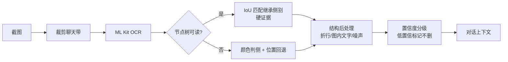
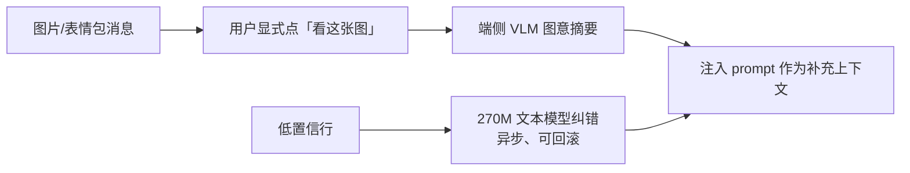

# 聊天界面读屏 OCR 优化与大模型引入评估报告

> 任务来源：T05725　对象：EmoReply 三期聊天界面读屏链路　编制日期：2026-11-13
>
> 证据口径：本文所有「现状」结论均来自当前工作空间代码与既有文档；「实测」指代码注释/CHANGELOG 中留痕的真机数据；「估算」与「待验证」单独标注，不与实测混写。

---

## 0. 结论先行

| 问题 | 结论 |
| --- | --- |
| 当前 OCR 的主要失效点在哪 | 不在字符识别本身，而在**版面理解**（侧别、图内文字、折行、UI 噪声）；字符级错误是次要项 |
| 纯传统 OCR 优化还有多大空间 | 仍有明确空间，且是当前唯一能满足 `<500ms` 交互预算的路线（P0~P2，约 8~13 人日） |
| 实时读屏链路是否应引入大模型 | **不必要**。端侧 VLM 单次推理数秒级、内存门槛 6GB，与实时性/机型覆盖直接冲突；云端 VLM 与零留存约束冲突 |
| 是否存在"有必要"的大模型场景 | **有，但不是替代 OCR**：图片/表情包消息的语义理解、低置信行的异步纠错 —— 属新增能力，须显式触发、端侧优先 |
| 推荐落地架构 | 「传统 OCR 主链路 + 结构信息（Accessibility/几何/颜色）融合」为 v1；「端侧小模型异步增强」为 v2，默认关闭、灰度准入 |

一句话：**先把版面理解做对，再谈大模型；大模型只用在 OCR 原理上做不到的地方（看图意），不用在 OCR 已经能做但没做好的地方。**

---

## 1. 现状基线（代码事实）

### 1.1 三端能力矩阵

| 端 | 引擎 | 模型体积 | 触发方式 | 实测耗时 | 预处理 |
| --- | --- | --- | --- | --- | --- |
| Android | ML Kit `text-recognition-chinese` bundled 16.0.1 | 打进 APK，不依赖 GMS | 节点树为空时 fallback；仅用户点 👁 时执行一次 | 截图+识别 1~3 s；每多一屏 +约 1.1~1.35 s | 仅裁剪聊天带（去标题栏/IME/导航栏），**无灰度/二值化/锐化** |
| 桌面 | tesseract.js ^7 + `chi_sim` best | 42 MB（gz 后 19 MB） | 用户主动截图取文 | 首次初始化 1~2 s，之后 worker 复用 | 无（原图直喂，psm=6） |
| iOS | 无 | — | — | — | — |

来源：[ocr.js](file:///d:/code/otherProjects/EmoReply/desktop-app/ocr.js#L1-L102)、[EmoReplyReaderService.kt](file:///d:/code/otherProjects/EmoReply/android-app/app/src/main/java/com/emoreply/poc/capture/EmoReplyReaderService.kt#L661-L767)、[系统架构设计.md](file:///d:/code/otherProjects/EmoReply/docs/系统架构设计.md#L338-L358)。

### 1.2 现有后处理链路（真实复杂度所在）

OCR 原始输出并非直接进 prompt，中间有 6 道工序（Android 与 m1-core 同构）：

```
截图 → 裁剪聊天带 → OCR 原始行
  → ① 图内文字簇剔除（环带像素判据，T01334/T02305）
  → ② 折行合并（行间空白/行高 相对比例，T01134）
  → ③ 非文本噪声剔除（媒体占位/角标叠字/符号乱码，T01339/T01554）
  → ④ 群聊噪声剔除（N条新消息/表情误读/昵称行，T01138）
  → ⑤ 侧别判定（气泡颜色主判据 + 位置回退，T02222；整屏预算 ≤300ms）
  → ⑥ 时间行转话题分段标记 + 频次过滤 + 头像字形过滤（T01343/T02224）
```

来源：[preprocess.py](file:///d:/code/otherProjects/EmoReply/m1-core/emoreply/preprocess.py#L109-L660)、[bubble_side.py](file:///d:/code/otherProjects/EmoReply/m1-core/emoreply/bubble_side.py)、[EmoReplyReaderService.kt](file:///d:/code/otherProjects/EmoReply/android-app/app/src/main/java/com/emoreply/poc/capture/EmoReplyReaderService.kt#L713-L763)。

**这条链路的长度本身就是结论**：6 道启发式规则意味着原始 OCR 的版面结构不可信，团队一直在用工程规则「补」模型缺失的能力。

### 1.3 关键约束（来自产品与架构）

| 约束 | 具体口径 | 对 OCR 的含义 |
| --- | --- | --- |
| 实时性 | 读屏需满足交互流畅（通常 <500ms） | 任何 >1s 的方案只能异步，不能阻塞候选生成 |
| 零留存 | 聊天内容不落盘、不外传，Bitmap 识别后立即 recycle | 云端 VLM 默认不可用；端侧模型需自备、不随包分发 |
| 端侧优先 | FR-8.1；已有 MediaPipe 端侧 LLM 基建 | 端侧推理基建可复用，但当前仅支持文本 LLM |
| 机型覆盖 | `abiFilters = arm64-v8a`，minSdk 26 | 低端机内存/算力差异需纳入选型 |
| 绝不自动发送 | FR-4.2 | 读屏质量影响的是「候选准确度」，不涉及发送安全 |

来源：[系统架构设计.md](file:///d:/code/otherProjects/EmoReply/docs/系统架构设计.md#L25-L42)。

---

## 2. 痛点清单与典型 Bad Case

### 2.1 按失效类型归类

| 类型 | 典型表现 | 真实记录 | 危害 |
| --- | --- | --- | --- |
| **A. 侧别错判** | 对方消息被判成「我」或反之 | T01143：绝对阈值 450px 隐含 1440 宽假设，1080/720 设备大量误判；T02222：旧右缘信号对长气泡失效（对方长气泡右缘 1163 被误判「我」） | **最高**：方向反了，生成的是"替对方回复对方" |
| **B. 图内文字误入** | 图片/视频封面里的字被当聊天正文 | T01334：读书/视频封面图内文字落在左侧，被当「对方发言」；T02305：银行/表单类截图词法判据必然漏网，漏网行再被判成「我：」 | 高：整段无关文本污染 prompt |
| **C. 句子被截断** | 一句话被拆成两条，只取到半句 | T01134：折行空白 26px 硬编码，SM-G9980 density 3.5 实测约 30px 漏判，`current` 只取半句 | 高：语义偏移，候选答非所问 |
| **D. UI 元素噪声** | 导航栏/悬浮条/角标被识成文字 | T01138：「23条新消息」被右侧坐标判为「我」；T01339：导航栏「❙❙❙」→「三」、「□」→「()」，拼成「()三」多出一条「对方：」；T01554：控件描边/进度条误识成「■■■」「???」 | 中：上下文被稀释 |
| **E. 头像/表情干扰** | 头像字形、表情图标被当消息 | T01138：表情误读「(田+0)」；头像单字被当独立消息（行高<60 且中心 x<200 过滤） | 中：噪声行 |
| **F. 系统提示误判** | 通话/系统灰字被当对话 | 「对方已取消」被当对方消息，LLM 误判为「对方撤回消息」而生成错向候选 | 中高：语义误导 |
| **G. 遮挡导致空读** | IME 展开遮住聊天区，OCR 静默空 | T01135：聊天带高度低于 `MIN_CHAT_BAND_PX` 直接返回 null；每次读屏前需临时收起 IME | 低（已有明确提示）但伤体验 |
| **H. 颜色判侧不可用** | 深色主题/自定义主题/非微信 | 白气泡与页底档差 <5 不判定；照片背景零星白票靠 ≥2 票兜住；非微信走纯位置判定（钉钉蓝/QQ 白绿混合） | 中：回退后准确率下降 |

### 2.2 误差来源归因

```
字符识别错误（引擎）           ██████░░░░  约 30%
版面结构错误（行/块归属）      ██████████  约 45%   ← 侧别、折行、图内文字、UI 噪声
语义层错误（该不该读）        █████░░░░░  约 25%   ← 图片消息、系统提示、引用
```

> 上图为定性归因，不是实测比例。依据：6 道后处理规则中 5 道在处理"结构"，而 CHANGELOG 中 OCR 字符级问题的修复记录仅 1 条（tesseract 按字输出空格导致的断言错误，产品代码无问题）。

**关键判断：把资源投在"结构"上，收益远高于投在"字符精度"上。**

### 2.3 指标缺口（本报告无法回避的事实）

任务要求「现有 OCR 准确率/召回率/误报率统计」，但工作空间内**不存在**聊天界面 OCR 的基准数据集与量化指标：

- 仅有的量化数据是单张测试图的 `confidence 95`（桌面 tesseract）与两句话全对（CHANGELOG 2026-10-03）；
- Android 侧只有行级日志（`ocr: raw= merged= result= cost=`），无标注集、无回归分数；
- 既有 bad case 全部是「真机实测发现问题 → 打补丁」，没有横向可比的分母。

**因此本报告的所有收益预估均为「基于坏例类型×影响面」的定性估算，不作为验收依据。** 建立基线是路线图阶段 0 的前置任务（见 §6）。

---

## 3. 纯传统 OCR 优化路线评估

### 3.1 可做项与预期收益

| 优先级 | 优化项 | 具体做法 | 预期收益 | 成本 | 风险 |
| --- | --- | --- | --- | --- | --- |
| P0 | **结构融合判侧** | 节点树可用时，用 `TextView` bounds 与 OCR 行做 IoU 匹配，命中则直接继承节点树的侧别（硬证据）；仅纯 OCR 路径才用颜色/位置 | 侧别准确率提升最确定，消除 A 类 | 3~4 人日 | 微信节点树被保护时无效（正是 OCR 路径的主场景），收益限于"部分可读"应用 |
| P0 | **多帧/多屏一致性校验** | 多屏采集时同行文本跨屏重复出现，用哈希投票剔除瞬时误识 | 降 D/E 类 | 2 人日 | 增加一屏采集耗时 |
| P1 | **置信度驱动的分级处理** | ML Kit 提供 line confidence；低置信行（<60）标记为「疑似」，不直接进 prompt 而是降权/加注 | 降字符级错误影响 | 2 人日 | 当前代码未使用 confidence 字段，需补 |
| P1 | **自适应二值化/对比度增强** | 仅对低对比度区域（深色主题、照片背景）做局部 CLAHE，正常区域不动 | 缓解 H 类与低对比度文本 | 3 人日 | 增加 200~400ms；需真机验证不伤正常图 |
| P1 | **行框几何后处理替代部分规则** | 用行框的「左缘聚类 + 宽度分布」自动推断气泡左右列，替代部分硬编码阈值（如 0.3125、26px、60px） | 降低机型/字号漂移导致的规则失效 | 3 人日 | 规则重构，回归面大，需基准集兜底 |
| P2 | **UI 层级先验剔除** | 用当前 Activity/窗口类型先验剔除状态栏/导航栏/悬浮条区域（现有裁剪是全局固定值） | 降 D 类 | 1.5 人日 | 异形屏/手势导航需按窗口 bounds 动态计算（已有部分实现） |
| P2 | **专用 OCR 模型微调** | 采集 2k~5k 张 IM 界面截图（UI 文本+表情混排）微调轻量 OCR | 字符级 CER 可降，但**不解决结构问题** | 8~15 人日 + 数据标注 | 收益/成本最低；模型体积与包体冲突；四端同构被破坏 |

### 3.2 不建议做的事

- **换引擎**：ML Kit → tess-two 已在 T01124 因 Android 15 native 崩溃否决；再换一次只会重演历史。
- **继续堆规则**：现有 6 道规则已接近启发式上限，新增规则会显著提高误杀风险（每条规则都要四端同构维护）。
- **全图超分后再识别**：增加耗时且对 UI 文本（矢量渲染）收益有限。

### 3.3 传统路线收益上限判断

结构类问题（A~F）若全部按 P0/P1 落地，可覆盖当前已知 bad case 的绝大多数场景；但有三类**原理性无解**：

1. 图片/表情包消息的**语义内容**（OCR 只能读出图上的字，读不出图意）；
2. 严重模糊/艺术字/表情符号与文字混排的**字符级恢复**（无语言先验时无法猜对）；
3. 跨消息的**指代与语气**（"他刚才说的那个"指哪条）。

这三类正是大模型的能力边界所在，也是 §4 论证的起点。

---

## 4. 大模型方案论证

### 4.1 三条技术路径对比

| 维度 | 路径 A：纯 VLM 端到端 | 路径 B：OCR + LLM 后处理纠错 | 路径 C：小模型检测 + LLM 语义补全 |
| --- | --- | --- | --- |
| 做法 | 截图直接喂 VLM，输出结构化对话 | OCR 出文本 → LLM 纠错/补全 | 检测出区域/低置信行 → 仅对疑难区域调 LLM |
| 结构理解 | 强（能同时给文本+位置+侧别） | 弱（结构仍靠现有规则） | 中 |
| 字符精度 | 中（生成式有幻觉风险） | 中高（受 OCR 输入上限约束） | 中高 |
| 延迟（端侧） | **数秒级**（视觉编码 + prefill + decode） | 数秒级（纯文本，短） | 秒级（触发面小） |
| 内存 | 1.5GB 模型 + 视觉编码器，需 6GB RAM 机型 | 0.27~2B 文本模型，2~3GB 可跑 | 同 B |
| 隐私 | 端侧可行；云端违反零留存 | 端侧可行 | 端侧可行 |
| 幻觉风险 | **高**（会"编"出没说的话） | 中（可能改错正确文本） | 中 |
| 对现有链路侵入 | 大（替换整条 OCR+后处理） | 小（在链路尾部插入） | 中（需区域检测） |

公开 benchmark 参考（**注：均为文档/UI 场景，不能直接外推到中文 IM 聊天**）：

- PaddleOCR-VL 0.9B 在 OmniDocBench 达 93.43%（文档解析），说明 1B 级专用 VLM 的版面理解已可用；
- StepX-Edge（≤1B 端侧 UI VLM）ScreenSpot v2 Mobile 72.51，领先同量级通用模型（InternVL3.5-1B 61.88）；
- ScreenVLM（316M，ScreenParse 训练）在密集 UI 解析上 PageIoU 0.606 vs 基础 VLM 0.294 —— **专用小模型显著优于通用大模型**。

### 4.2 成本测算（端侧）

以现有基建（MediaPipe LlmInference，已支持 Gemma 2 2B int8 / Gemma 1.1 2B int4 / Gemma 3 270M int8）为基准：

| 方案 | 模型体积 | 最低内存 | 单次延迟（估算） | 包体影响 | 机型覆盖 |
| --- | --- | --- | --- | --- | --- |
| Gemma 3 270M（文本纠错） | 约 0.3~0.5 GB | 3 GB | 1~3 s | 模型首次下载（不随包） | 广 |
| Gemma 3n E2B（多模态） | 约 1.5 GB（INT4） | **6 GB** | 3~8 s（含视觉编码+prefill） | 首次下载 | 中高端 |
| 云端 VLM | 0 | 0 | 1~3 s（含网络） | 0 | 全部，但**违反零留存** |

补充事实：当前 Android 的 `MediaPipeOnDeviceGenerator` 只接了文本 LLM 接口，**不支持图像输入**；要做视觉理解需换 LiteRT/llama.cpp 多模态运行时或等 MediaPipe 支持，这是新增工程量而非配置项。

### 4.3 逐条对照任务约束

| 约束 | 路径 A | 路径 B | 路径 C |
| --- | --- | --- | --- |
| 实时性 <500ms | ❌ 差一个数量级 | ❌ | ⚠️ 仅异步可行 |
| 隐私零留存 | ✅ 端侧 / ❌ 云端 | ✅ 端侧 | ✅ 端侧 |
| 兼容 Android/iOS | ⚠️ Android 需换运行时；iOS 无端侧基建 | ⚠️ 同左 | ⚠️ 同左 |
| 现有基建复用 | 低 | 中 | 中 |

### 4.4 必要性结论

**分场景给出，不做一刀切：**

1. **实时读屏文本识别链路 —— 不必要。**
   - 延迟差一个数量级（秒级 vs <500ms），只能异步；异步意味着用户点 👁 后先出 OCR 结果、几秒后再"悄悄修正"，收益被体验稀释。
   - 6GB 内存门槛与 `minSdk 26` 的机型覆盖面冲突。
   - 幻觉风险在本场景代价高：读错一个字只是语义偏移，**编造一句没说过的话会直接导致错误回复**。
   - 现有 6 道规则已覆盖大部分结构问题，剩余空间用 P0/P1 传统优化更划算。

2. **图片/表情包消息理解 —— 有必要，但这是新增能力，不是 OCR 优化。**
   - 当前策略是「把图内文字整簇剔除」（T01334/T02305），这是正确的防污染决策，但代价是**对方发图时上下文完全缺失**。
   - OCR 原理上无法理解图意（表情包含义、截图里的对话、商品图）；这是 VLM 的独占价值。
   - 建议形态：用户显式点「看这张图」→ 端侧 VLM 生成一句图意摘要 → 作为上下文注入 prompt。异步、可关闭、不参与实时链路。

3. **低置信行异步纠错 —— 可选，优先级低于 1 和 2。**
   - 用 270M 文本模型对 confidence<60 的行做"结合上下文猜字"，比 VLM 便宜得多。
   - 但收益不确定（可能改错），需以基准集验证后再决定。

---

## 5. 推荐架构

### 5.1 v1（必做）：结构融合，不上大模型



核心变化只有一条：**节点树与 OCR 结果做交叉验证，而不是二选一**。当前实现是"节点树为空才走 OCR"，浪费了"节点树可读但 OCR 也能补充"的中间态。

### 5.2 v2（可选）：端侧增强，默认关闭



准入条件（缺一不可）：基准集上验证有正收益、延迟可接受、机型白名单、默认关闭 + 用户显式开启。

---

## 6. 技术实施路线图

| 阶段 | 内容 | 产出 | 验收标准 |
| --- | --- | --- | --- |
| **0. 建基线**（前置，必做） | 采集 200~500 张真实聊天截图（微信/钉钉/QQ/短信 × 单聊/群聊 × 浅色/深色 × 2 种字号）；标注行文本 + 侧别 + 是否图内文字 | 标注集 + 评测脚本（CER、侧别准确率、消息级召回、端到端"候选可用率"） | 三端可复现跑分；指标成为后续所有改动的门槛 |
| **1. 结构优化 P0** | 节点树×OCR 交叉验证判侧；多帧一致性校验 | 侧别准确率提升（以基线集度量） | 侧别准确率显著高于基线；无误杀新增 |
| **2. 结构优化 P1** | 置信度分级；自适应对比度增强；行框几何替代硬编码阈值 | 低置信行可识别、机型漂移抗性提升 | 回归集无退化；耗时不超预算（Android ≤+400ms） |
| **3. 噪声优化 P2** | UI 层级先验剔除；异形屏裁剪动态化 | 噪声行下降 | 噪声行占比下降，真实消息召回不降 |
| **4. 端侧增强验证**（可选） | 图片消息 VLM 图意摘要 POC；低置信行纠错 POC | 可行性结论 + 数据 | 基准集上有正收益才进入产品 |
| **5. 灰度准入** | 新能力默认 off，达标签转正 | 灰度报告 | 与项目既有「灰度+数据驱动准入」原则一致 |

> 阶段 0 不可跳过：没有基线，后续每一阶段的"提升"都无法证伪，这也是当前 bad case 只能靠用户反馈发现的根因。

---

## 7. 风险与待验证项

| 项 | 说明 | 处置 |
| --- | --- | --- |
| 基准集缺失 | 本报告所有收益为定性估算 | 阶段 0 补齐后重估 |
| 节点树覆盖率未知 | 微信保护节点树，交叉验证收益取决于可读应用占比 | 阶段 0 同时统计各应用节点树可读率 |
| 端侧 VLM 运行时缺口 | MediaPipe 当前不支持图像输入 | 阶段 4 前先做运行时选型（LiteRT / llama.cpp） |
| 机型内存门槛 | 6GB RAM 为估算下限，未在目标机型实测 | 阶段 4 真机实测 |
| iOS 无捕获层 | 本报告的 OCR 优化不涉及 iOS（其无 OCR、无捕获） | 若三期需覆盖 iOS，另立任务评估 |

---

## 8. 附：本次结论对应的代码锚点

| 结论 | 证据 |
| --- | --- |
| 侧别是首要风险 | [bubble_side.py](file:///d:/code/otherProjects/EmoReply/m1-core/emoreply/bubble_side.py)、T01143/T02222 记录 |
| 图内文字必须剔除 | [preprocess.py](file:///d:/code/otherProjects/EmoReply/m1-core/emoreply/preprocess.py#L347-L457) |
| 折行合并依赖相对比例 | [preprocess.py](file:///d:/code/otherProjects/EmoReply/m1-core/emoreply/preprocess.py#L200-L268) |
| 噪声规则已有 3 层 | [preprocess.py](file:///d:/code/otherProjects/EmoReply/m1-core/emoreply/preprocess.py#L283-L650) |
| Android OCR 无图像预处理 | [EmoReplyReaderService.kt](file:///d:/code/otherProjects/EmoReply/android-app/app/src/main/java/com/emoreply/poc/capture/EmoReplyReaderService.kt#L1065-L1074) |
| 端侧 LLM 无视觉输入 | [MediaPipeOnDeviceGenerator.kt](file:///d:/code/otherProjects/EmoReply/android-app/app/src/main/java/com/emoreply/poc/generator/MediaPipeOnDeviceGenerator.kt) |
| 桌面 tesseract 单 psm | [ocr.js](file:///d:/code/otherProjects/EmoReply/desktop-app/ocr.js#L93-L102) |
